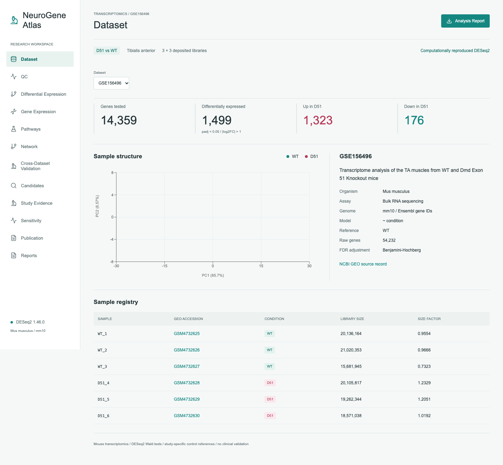
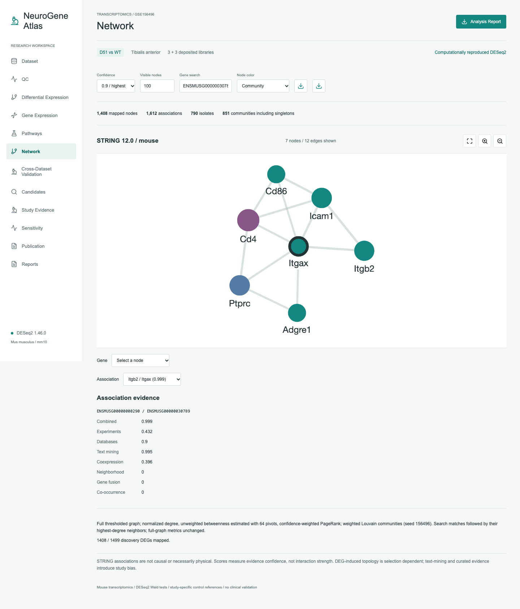
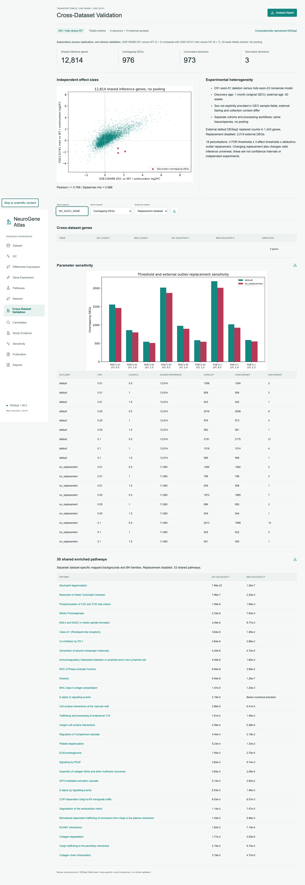

# NeuroGene Atlas

Reproducible multi-study transcriptomics and network-based exploratory candidate gene analysis in mouse dystrophin-deficient tibialis anterior muscle.

**Author: Berfin Nida Öztürk. Version 0.5.1. Public MIT source; research data are not bundled.**

[Source repository](https://github.com/berfinida/NeuroGene-Atlas) · [Versioned source releases](https://github.com/berfinida/NeuroGene-Atlas/releases)

## Research Objectives

Inspect real count-based differential expression, quantify cross-model agreement without pooling incompatible experiments, and explain exploratory candidate rankings with pathway, network and sensitivity evidence. This is research software, not a diagnostic or clinical biomarker system.

## Datasets And Scientific Status

| Study | Libraries | Contrast and age | Default DEGs / tested |
| --- | --- | --- | --- |
| [GSE156496](https://www.ncbi.nlm.nih.gov/geo/query/acc.cgi?acc=GSE156496) | 3 WT + 3 D51 | D51 / WT, 1 month | 1,499 / 14,359 |
| [GSE132741](https://www.ncbi.nlm.nih.gov/geo/query/acc.cgi?acc=GSE132741) | 7 WT + 8 mdx | mdx / WT, 30 weeks | 2,419 / 14,494 |
| [GSE284723](https://www.ncbi.nlm.nih.gov/geo/query/acc.cgi?acc=GSE284723) | 5 floxed controls + 4 mKO | Conditional mKO / controls, 4–6 months | 1,817 / 15,009; exploratory only |

DEG thresholds: BH-adjusted p < 0.05 and absolute **unshrunken** log2FC > 1. Discovery/mdx comparison: 12,814 common valid-FDR genes; 976 shared DEGs, 973 concordant and 3 discordant. Without external automatic outlier replacement: 896 shared DEGs, 893 concordant and 3 discordant. All-common-finite effect Pearson r = 0.7651. These are exploratory mouse comparisons, not clinical validation.

**GSE284723 warning:** GEO describes 10 mice, the workbook has 9 libraries, and article Figure 4 describes 8 mice. Animal identifiers and the reason for the discrepancy are unconfirmed. No samples were silently dropped. Third-dependent findings, including 572 three-study stable candidates, are excluded from validated headline evidence. See [sample audit](docs/GSE284723_SAMPLE_AUDIT.md). Numerical reproduction does not resolve biological uncertainty.

## Real Dashboard

Actual local production screenshots, not mockups:





## Functionality

- Twelve views: Dataset, QC, Differential Expression, Gene Expression, Pathways, Network, Cross-Dataset Validation, Candidates, Study Evidence, Sensitivity, Publication and Reports.
- Literal gene search, DEG thresholds, pagination, discovery raw/normalized/VST expression, three-study dataset/QC inspection.
- Cytoscape.js confidence filtering, communities, gene search, evidence scores, degree, approximate betweenness and PageRank; full network exports.
- Explained bounded candidate scores and weight/outlier sensitivity; original ranking remains frozen before the third study.
- Real CSV, PNG, SVG, PDF and HTML artifacts with methods, versions and SHA-256 provenance.

Primary DEG/expression/pathway views remain discovery-specific; dataset selection covers Dataset/QC. Volcano and MA are static figures. No human cohort or clinical validation workflow is implemented.

## Methodology

Verify deposited nonnegative integer counts, sample alignment and contrast direction. DESeq2 uses `~ condition`, median-ratio normalization, negative-binomial Wald tests, independent filtering and BH FDR. Default count filter: at least 10 counts in at least 3 samples. Preserve unshrunken statistics separately from apeglm-shrunken effects. Python exploratory statistics never substitute for DESeq2.

Analyze studies separately because genotype, age, laboratory, annotation and processing differ. Exact unique Ensembl bridges exclude ambiguous external symbols. Reactome v95 enrichment uses study-specific valid-FDR mapped backgrounds and full eligible term-family BH adjustment. STRING v12, taxon 10090: 1,408 mapped discovery genes and 17,872 associations at confidence >= 0.4. Associations are not causality or necessarily physical interaction.

Candidate weights: statistical/effect/consistency/pathway/network/replication = 0.25/0.20/0.15/0.10/0.10/0.20; bounded components and fixed missing-evidence denominator. Network contributes at most 10% but can change close ranks. See [methods](docs/SCIENTIFIC_METHODS.md) and [candidate evidence](CANDIDATE_GENE_EVIDENCE.md).

## Stack And Requirements

Next.js 15.5.27, React 19.1.4, TypeScript 5.8.3, Recharts, Cytoscape.js, FastAPI, pandas, SciPy, NetworkX and Playwright.

Locally tested: macOS ARM64, Node 22.23.1/npm 10.9.8, Python 3.14.5, R 4.4.3, DESeq2 1.46.0, apeglm 1.28.0, jsonlite 2.0.0. Use Node 22 and Python 3.14 with checked-in locks. Source-only Linux CI passed; full-data scientific validation and R reproduction remain local, not hosted. Allow several GB for installed dependencies, browser binaries and analysis scratch space. Docker was unavailable; the optional container is not claimed tested.

## Installation

Clone the public source or extract the source Release ZIP. No public research-bundle URL is provided.

```sh
git clone https://github.com/berfinida/NeuroGene-Atlas.git
cd NeuroGene-Atlas
python3.14 -m venv .venv
.venv/bin/python -m pip install -r backend/requirements.lock.txt
.venv/bin/python -m pip check
cd frontend
npm ci
npx playwright install chromium
cd ..
```

**Research data are deliberately excluded from Git.** Source-only tests work without data; scientific views need real outputs. To install the existing verified local Phase 5 bundle:

```sh
.venv/bin/python scripts/install_research_bundle.py \
  --file release/NeuroGene_Atlas_Research_Results_FINAL.zip \
  --sha256 f211ba30301105074bde3d59596ca1645edadd1b1e993ab8f14f088f7751c3bd
```

The importer verifies SHA-256 and refuses to overwrite changed local artifacts. See [release strategy](docs/RELEASE_STRATEGY.md) for public original-input URLs, checksums and redistribution restrictions. Source-only missing-data responses are not scientific findings.

## Environment And Running

`.env.example` documents shell variables, not credentials. Set `API_INTERNAL_URL` **before building**; the root `.env` is not automatically loaded. No OpenAI/GitHub/API key is required.

Backend terminal, repository root:

```sh
.venv/bin/python -m uvicorn backend.main:app --host 127.0.0.1 --port 8000
```

Frontend terminal:

```sh
cd frontend
API_INTERNAL_URL=http://127.0.0.1:8000 npm run build
npm run start -- --port 3000
```

Open http://127.0.0.1:3000; API schema at http://127.0.0.1:8000/docs. Development: `API_INTERNAL_URL=http://127.0.0.1:8000 npm run dev`. Other backend ports require rebuilding with that destination. The audited local instance uses frontend 3005/backend 8005.

## Reproducing Analyses

Install the original inputs and stored outputs, then activate the pinned R environment from `environment.yml` / `environment.osx-arm64.lock.txt`. Inspect `Dockerfile.analysis` before using it; Docker was not tested.

```sh
.venv/bin/python scripts/final_reproduction.py --rscript /path/to/pinned/Rscript
```

This reconstructs all three input matrices in isolated scratch space, executes actual R fits, compares stored tables at rtol 1e-8/atol 1e-10 and checks original hashes. It writes the Phase 5 ledger; preserve earlier evidence before rerunning. The recorded run matched 24 tables with maximum numeric difference zero, on the same host and existing R installation, not an independent analyst or second R environment. Context-adjusted fits and FASTQ alignments were not rerun in that audit.

## Testing And CI

Source-only software fixtures are labeled synthetic and are never scientific outputs:

```sh
.venv/bin/python -m unittest discover -s tests/core -v
.venv/bin/python scripts/repository_audit.py
cd frontend
npm run typecheck
npm audit --json
npm run build
# With source-only services running:
E2E_CORE=1 E2E_BASE_URL=http://127.0.0.1:3000 npx playwright test
cd ..
```

Full suite requires the verified research bundle and actual backend/frontend:

```sh
.venv/bin/python -m unittest discover -s tests -v
.venv/bin/python scripts/final_validate.py --build-only \
  --api-url http://127.0.0.1:8000 --out-dir results/validation/github
# Start services after the build, then:
.venv/bin/python scripts/final_validate.py \
  --api-url http://127.0.0.1:8000 --base-url http://127.0.0.1:3000 \
  --out-dir results/validation/github
```

Stop the production frontend before rebuilding its `.next` directory. [Hosted source-only CI passed](https://github.com/berfinida/NeuroGene-Atlas/actions/runs/38176815275): 14 Python/API/archive tests, 2 Chromium desktop/mobile tests, dependency checks, source privacy audit, TypeScript and production build. Actions reruns on push/PR. The manual research job is intentionally skipped: no approved public research bundle exists. Its optional inputs require an approved HTTPS URL and independently verified SHA-256. Local full-data validation is separate: 62 Python/statistical tests (23 API tests), 30 browser checks and 151 API/download requests passed. [Release validation](GITHUB_RELEASE_READINESS.md) records scope and limitations.

## Architecture

| Path | Role |
| --- | --- |
| `frontend/app/`, `frontend/e2e*/` | Dashboard and browser tests |
| `backend/` | Read-only scientific API and pinned Python locks |
| `scripts/rna_seq/`, `scripts/discovery/` | DESeq2, pathways, networks and comparison |
| `scripts/final_*.py` | Isolated reproduction, validation and packaging |
| `tests/`, `tests/core/` | Real-data integrity and source-only software checks |
| `config/`, `environment*` | Cohort and environment configuration |
| `docs/`, `.github/` | Scientific documentation and CI |
| `data/`, `results/`, `release/` | Local artifacts, Git-ignored |

See [architecture](docs/ARCHITECTURE.md). [Previous README](docs/history/README_PHASE5.md) preserves historical phase documentation, not current certification.

## Scientific Limitations

Small bulk-mouse cohorts, composition effects, age/genotype/lab heterogeneity, incomplete animal/sex metadata, annotation loss, selection-inflated DEG concordance, external outlier-replacement sensitivity, continuous-covariate Cook-filter differences, and unresolved third-study cohort counts. No pooled estimate, FASTQ realignment, independent R environment, clinical validation, full WCAG certification or penetration test. Chromium mobile emulation is not real-device certification. See [limitations](docs/LIMITATIONS.md).

## Provenance And Licensing

MIT applies to original code/documentation, not external datasets, third-party dependencies, articles or their figures. GEO public access is not a blanket redistribution license. Reactome/STRING and dataset-specific terms remain applicable. The raw-inclusive research bundle is **not cleared for public redistribution**. Dashboard screenshots use our own computed plots, not copied article figures. See [provenance](docs/DATA_PROVENANCE.md), [license review](docs/DEPENDENCY_AND_DATA_LICENSES.md) and [release strategy](docs/RELEASE_STRATEGY.md).

## Citation And Contributions

[CITATION.cff](CITATION.cff) records author/version and source URL; no DOI or Zenodo archival is claimed. Cite original datasets and DESeq2/apeglm/Reactome/STRING methods separately. An approved future Zenodo deposition may provide a DOI.

Read [CONTRIBUTING.md](CONTRIBUTING.md), [SECURITY.md](SECURITY.md) and [CODE_OF_CONDUCT.md](CODE_OF_CONDUCT.md). Preserve scientific provenance, label synthetic software fixtures, and document executed tests. Owner approval covers this public MIT source release only, not research-data redistribution.
